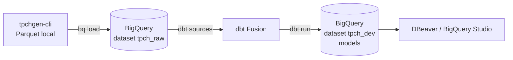
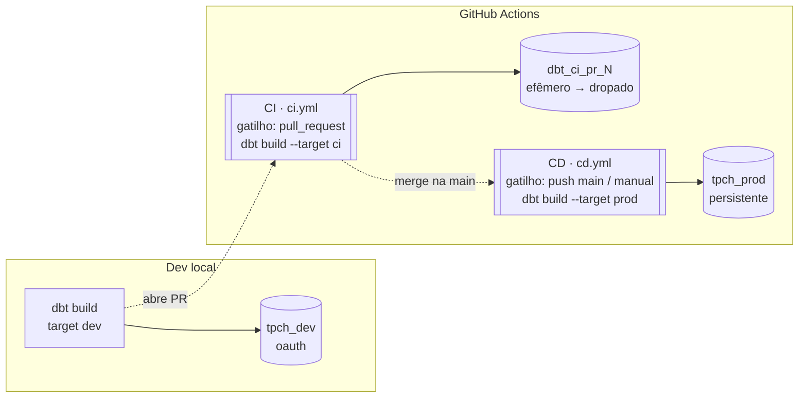

# TPC-H Analytics Engineering

Projeto de estudo de engenharia analítica de ponta a ponta usando o dataset
[TPC-H](https://www.tpc.org/tpch/). O repositório serve como **tutorial**: gera
os dados localmente, carrega no **BigQuery** e modela com **[dbt](https://www.getdbt.com/)**.



## Sumário

1. [Pré-requisitos](#1-pré-requisitos)
2. [Gerar o dataset TPC-H](#2-gerar-o-dataset-tpc-h)
3. [Carregar os dados no BigQuery](#3-carregar-os-dados-no-bigquery)
4. [Instalar e configurar o dbt](#4-instalar-e-configurar-o-dbt)
5. [O projeto dbt](#5-o-projeto-dbt)
6. [Consultar os dados (DBeaver / BigQuery Studio)](#6-consultar-os-dados)
7. [Troubleshooting](#7-troubleshooting)
8. [CI/CD (GitHub Actions)](#8-cicd-github-actions)
9. [Estrutura do repositório](#estrutura-do-repositório)

---

## 1. Pré-requisitos

- **Python 3.11+** e o [Google Cloud SDK](https://cloud.google.com/sdk/docs/install)
  (`gcloud`, `bq`) instalados.
- Um projeto no GCP com a **BigQuery API** habilitada.
- Autenticação do `gcloud` (feita uma vez):

```bash
gcloud auth login                        # login da sua conta
gcloud auth application-default login    # credenciais que o dbt/DBeaver reaproveitam (ADC)
gcloud config set project SEU_PROJECT_ID
```

> **Sobre chaves de service account:** este projeto **não usa** chave (arquivo JSON).
> Muitas organizações bloqueiam a criação de chaves com a policy
> `iam.disableServiceAccountKeyCreation` — e, mesmo sem bloqueio, para
> desenvolvimento local o método **OAuth** (Application Default Credentials) é o
> recomendado e mais seguro. É o que usamos em todo o tutorial.

## 2. Gerar o dataset TPC-H

Os dados são gerados localmente com o [`tpchgen-cli`](https://pypi.org/project/tpchgen-cli/)
e salvos como Parquet em `tpch_dataset/` (ignorado no git — arquivos grandes,
gerados localmente).

```bash
python3 -m venv venv
source venv/bin/activate
pip install -r requirements.txt

tpchgen-cli parquet -s 1 --output-dir tpch_dataset
```

`-s 1` = scale factor 1 (~1 GB de dados brutos, ~345 MB em Parquet). Gera 8
tabelas: `customer`, `lineitem`, `nation`, `orders`, `part`, `partsupp`,
`region`, `supplier`. O notebook `create_tpch.ipynb` traz um exemplo de leitura
com pandas.

## 3. Carregar os dados no BigQuery

Você **não precisa** passar pelo Google Cloud Storage: como cada arquivo local
tem menos de 10 GB, dá para carregar direto com `bq load`. O Parquet já carrega o
**schema embutido**, então o BigQuery detecta os tipos das colunas sozinho.

```bash
# 1. Criar o dataset que guarda as tabelas cruas
bq mk --location=US tpch_raw

# 2. Carregar as 8 tabelas direto dos arquivos locais
for t in customer lineitem nation orders part partsupp region supplier; do
  bq load --source_format=PARQUET tpch_raw.$t ./tpch_dataset/$t.parquet
done
```

> **Quando usar o GCS?** Se os arquivos passarem de 10 GB, se você quiser
> recarregar sem reenviar do PC, ou usar *external tables*. Nesse caso:
> `gcloud storage cp tpch_dataset/*.parquet gs://SEU_BUCKET/tpch/` e depois aponte
> o `bq load` para `gs://SEU_BUCKET/tpch/$t.parquet`. A região do bucket e do
> dataset precisam ser compatíveis.

## 4. Instalar e configurar o dbt

Usamos o **dbt Fusion** (motor novo, em Rust) através da **extensão oficial da
dbt Labs no VS Code** — ela instala o motor sozinha, então **não** é preciso
`pip install dbt-core`.

1. Instale a extensão **dbt** (dbt Labs) no VS Code e aceite instalar o *dbt
   engine* (Fusion) quando ela oferecer.
2. Configure o perfil de conexão em `~/.dbt/profiles.yml`. Use o
   [`tpch/profiles.example.yml`](tpch/profiles.example.yml) como base:

```yaml
tpch:
  target: dev
  outputs:
    dev:
      type: bigquery
      method: oauth                  # reaproveita o gcloud (ADC) — sem chave
      database: SEU_PROJECT_ID       # id do seu projeto GCP
      schema: tpch_dev               # dataset onde o dbt cria os models
      location: US                   # precisa bater com o dataset tpch_raw
      threads: 4
```

3. Valide a conexão (de dentro de `tpch/`):

```bash
cd tpch
dbt debug     # deve terminar com "All checks passed!"
```

> Repare na separação: os dados **crus** ficam em `tpch_raw`; o dbt constrói os
> **seus models** em `tpch_dev`. Nunca escrevemos por cima do dataset cru.

## 5. O projeto dbt

O projeto vive na pasta `tpch/`. As `sources` apontam para o `tpch_raw` e os
models de staging renomeiam/limpam as colunas por cima.

`tpch/models/staging/_tpch__sources.yml` declara as 8 tabelas cruas. Um model de
staging fica assim:

```sql
-- tpch/models/staging/stg_tpch__orders.sql
select
    o_orderkey    as order_id,
    o_custkey     as customer_id,
    o_orderstatus as status,
    o_totalprice  as total_price,
    o_orderdate   as order_date
from {{ source('tpch', 'orders') }}
```

Rodar:

```bash
cd tpch
dbt run       # constrói os models no BigQuery (dataset tpch_dev)
dbt test      # roda os testes
dbt build     # run + test de uma vez
```

## 6. Consultar os dados

### BigQuery Studio (zero setup)
Abra o [console do BigQuery](https://console.cloud.google.com/bigquery) e rode SQL
direto no navegador.

### DBeaver
O DBeaver tem driver nativo de BigQuery. Como não usamos chave de service
account, autentique com **Application Default Credentials** (as mesmas do dbt):

1. *New Database Connection → Google BigQuery* (o DBeaver baixa o driver na 1ª vez).
2. Preencha o **Project** com o id do seu projeto; deixe o campo de *key file* vazio.
3. Na aba **Driver properties**, adicione:
   - `OAuthType` = `3`  (Application Default Credentials)
   - `ProjectId` = `SEU_PROJECT_ID`
4. *Test Connection* — conecta sem pedir chave.

```sql
select * from `SEU_PROJECT_ID.tpch_raw.orders` limit 100;
select * from `SEU_PROJECT_ID.tpch_dev.stg_tpch__orders` limit 100;
```

## 7. Troubleshooting

Erros reais que apareceram montando este projeto e como resolver:

| Sintoma | Causa | Correção |
|---|---|---|
| `lookup oauth2.googleapis.com ... no such host` (intermitente) | Wi-Fi sem DNS fixo, usando resolvedor instável do roteador | `sudo networksetup -setdnsservers Wi-Fi 8.8.8.8 8.8.4.4 1.1.1.1` e limpar o cache: `sudo dscacheutil -flushcache && sudo killall -HUP mDNSResponder` |
| `Dataset ... was not found in location us-east1` | `location` do perfil não bate com a região do dataset (`US`) | Usar `location: US` no `profiles.yml` |
| `Storage API is not available for query` | Consequência do DNS instável (falha ao buscar o token OAuth) | Corrigir o DNS (acima) |
| "A criação da chave da conta de serviço está desativada" | Org policy `iam.disableServiceAccountKeyCreation` | Não precisa de chave — use `method: oauth` (ADC) |

## 8. CI/CD (GitHub Actions)

O repositório roda um pipeline de **CI/CD** que simula um fluxo de trabalho real:
cada mudança é validada num Pull Request antes de entrar, e o que entra na `main`
é publicado em produção automaticamente. Tudo com **GitHub Actions** — nenhuma
máquina fica ligada 24/7; o GitHub aluga um runner limpo a cada evento.



**Um código, três alvos** — o mesmo projeto dbt aponta para datasets diferentes
conforme o contexto:

| Contexto | Gatilho | Dataset no BigQuery | Vida do dado |
|---|---|---|---|
| **Dev** | você, na mão (oauth) | `tpch_dev` | persistente, seu playground |
| **CI** | abrir/atualizar um PR | `dbt_ci_pr_<N>` | efêmero — criado e **dropado** no mesmo run |
| **CD** | merge na `main` ou botão manual | `tpch_prod` | persistente, a fonte da verdade |

**Autenticação sem segredo no repo.** Os workflows usam uma *service account* via
`method: service-account`. A chave **não** vive no código: fica no **GitHub Secret**
`GCP_SA_KEY` e é materializada num keyfile em runtime. O
[`tpch/deploy/profiles.template.yml`](tpch/deploy/profiles.template.yml) é versionado
de propósito porque contém **apenas** referências `env_var()` — zero credencial.
É o mesmo princípio do dev local, só trocando `oauth` por `service-account`.

> **Por que a CI usa um schema efêmero?** Para isolar cada PR: dois PRs abertos ao
> mesmo tempo não se atropelam, e nada suja o `tpch_dev` (seu) nem o `tpch_prod`.
> O `dbt-bigquery` **cria o dataset sozinho** quando ele não existe; a limpeza no
> fim do workflow (`delete_dataset`, `if: always()`) evita datasets órfãos.

Arquivos:

- [`.github/workflows/ci.yml`](.github/workflows/ci.yml) — CI, roda em cada PR.
- [`.github/workflows/cd.yml`](.github/workflows/cd.yml) — CD, roda no merge/manual.
- [`tpch/deploy/profiles.template.yml`](tpch/deploy/profiles.template.yml) — profile
  dos ambientes automatizados (targets `ci` e `prod`), sem segredo.

> **Pré-requisito no GCP:** a service account precisa dos papéis
> `roles/bigquery.jobUser` e `roles/bigquery.dataEditor` no projeto para rodar
> queries e criar os datasets.

## Estrutura do repositório

```
.
├── .github/workflows/
│   ├── ci.yml                 # CI: dbt build em schema efêmero a cada PR
│   └── cd.yml                 # CD: dbt build em tpch_prod no merge/manual
├── create_tpch.ipynb          # leitura exploratória dos Parquet com pandas
├── requirements.txt           # tpchgen-cli + libs de exploração
├── tpch_dataset/              # dados gerados (ignorado no git)
└── tpch/                      # projeto dbt
    ├── dbt_project.yml
    ├── profiles.example.yml   # modelo de ~/.dbt/profiles.yml (dev, oauth)
    ├── deploy/
    │   └── profiles.template.yml  # profile de CI/CD (env_var, sem segredo)
    └── models/staging/
        ├── _tpch__sources.yml
        ├── stg_tpch__customer.sql
        └── stg_tpch__orders.sql
```

## Próximos passos

- Criar os staging models das demais tabelas (`lineitem`, `part`, `supplier`, ...).
- Adicionar testes (`unique`, `not_null`) nas chaves em `_tpch__sources.yml`.
- Construir a camada de marts (fatos e dimensões) sobre os staging models.
- Evoluir a CI para **Slim CI** (`state:modified+` com deferral) — rodar só o que mudou.
- Orquestração dedicada (Dagster) e camada de visualização (Evidence.dev / Lightdash).
- Definir métricas no **Semantic Layer** (MetricFlow) sobre os marts.
