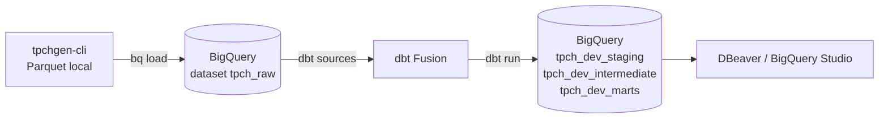
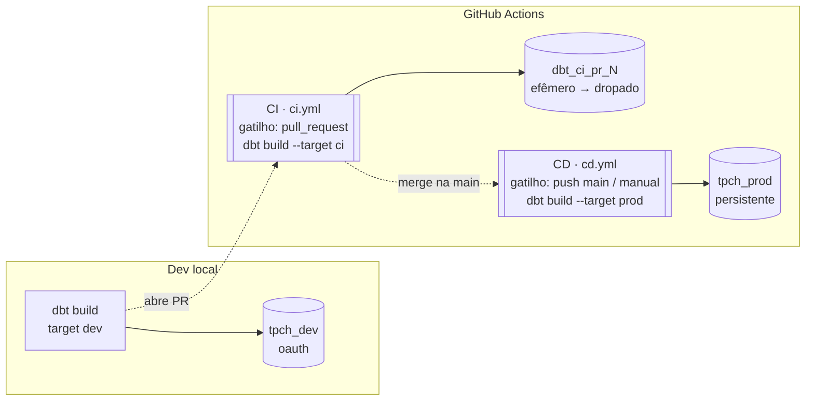

# TPC-H Analytics Engineering

Projeto de estudo de engenharia analítica de ponta a ponta usando o dataset
[TPC-H](https://www.tpc.org/tpch/). O repositório serve como **tutorial**: gera
os dados localmente, carrega no **BigQuery** e modela com **[dbt](https://www.getdbt.com/)**.



## Sumário

1. [Pré-requisitos](#1-pré-requisitos)
2. [Gerar o dataset TPC-H](#2-gerar-o-dataset-tpc-h)
3. [Carregar os dados no BigQuery](#3-carregar-os-dados-no-bigquery)
4. [Instalar e configurar o dbt](#4-instalar-e-configurar-o-dbt)
5. [O projeto dbt](#5-o-projeto-dbt)
6. [Consultar os dados (DBeaver / BigQuery Studio)](#6-consultar-os-dados)
7. [Troubleshooting](#7-troubleshooting)
8. [CI/CD (GitHub Actions)](#8-cicd-github-actions)
9. [Estrutura do repositório](#estrutura-do-repositório)

---

## 1. Pré-requisitos

- **Python 3.11+** e o [Google Cloud SDK](https://cloud.google.com/sdk/docs/install)
  (`gcloud`, `bq`) instalados.
- Um projeto no GCP com a **BigQuery API** habilitada.
- Autenticação do `gcloud` (feita uma vez):

```bash
gcloud auth login                        # login da sua conta
gcloud auth application-default login    # credenciais que o dbt/DBeaver reaproveitam (ADC)
gcloud config set project SEU_PROJECT_ID
```

> **Sobre chaves de service account:** este projeto **não usa** chave (arquivo JSON).
> Muitas organizações bloqueiam a criação de chaves com a policy
> `iam.disableServiceAccountKeyCreation` — e, mesmo sem bloqueio, para
> desenvolvimento local o método **OAuth** (Application Default Credentials) é o
> recomendado e mais seguro. É o que usamos em todo o tutorial.

## 2. Gerar o dataset TPC-H

Os dados são gerados localmente com o [`tpchgen-cli`](https://pypi.org/project/tpchgen-cli/)
e salvos como Parquet em `tpch_dataset/` (ignorado no git — arquivos grandes,
gerados localmente).

```bash
python3 -m venv venv
source venv/bin/activate
pip install -r requirements.txt

tpchgen-cli parquet -s 1 --output-dir tpch_dataset
```

`-s 1` = scale factor 1 (~1 GB de dados brutos, ~345 MB em Parquet). Gera 8
tabelas: `customer`, `lineitem`, `nation`, `orders`, `part`, `partsupp`,
`region`, `supplier`. O notebook `create_tpch.ipynb` traz um exemplo de leitura
com pandas.

## 3. Carregar os dados no BigQuery

Você **não precisa** passar pelo Google Cloud Storage: como cada arquivo local
tem menos de 10 GB, dá para carregar direto com `bq load`. O Parquet já carrega o
**schema embutido**, então o BigQuery detecta os tipos das colunas sozinho.

```bash
# 1. Criar o dataset que guarda as tabelas cruas
bq mk --location=US tpch_raw

# 2. Carregar as 8 tabelas direto dos arquivos locais
for t in customer lineitem nation orders part partsupp region supplier; do
  bq load --source_format=PARQUET tpch_raw.$t ./tpch_dataset/$t.parquet
done
```

> **Quando usar o GCS?** Se os arquivos passarem de 10 GB, se você quiser
> recarregar sem reenviar do PC, ou usar *external tables*. Nesse caso:
> `gcloud storage cp tpch_dataset/*.parquet gs://SEU_BUCKET/tpch/` e depois aponte
> o `bq load` para `gs://SEU_BUCKET/tpch/$t.parquet`. A região do bucket e do
> dataset precisam ser compatíveis.

## 4. Instalar e configurar o dbt

Usamos o **dbt Fusion** (motor novo, em Rust) através da **extensão oficial da
dbt Labs no VS Code** — ela instala o motor sozinha, então **não** é preciso
`pip install dbt-core`.

1. Instale a extensão **dbt** (dbt Labs) no VS Code e aceite instalar o *dbt
   engine* (Fusion) quando ela oferecer.
2. Configure o perfil de conexão em `~/.dbt/profiles.yml`. Use o
   [`tpch/profiles.example.yml`](tpch/profiles.example.yml) como base:

```yaml
tpch:
  target: dev
  outputs:
    dev:
      type: bigquery
      method: oauth                  # reaproveita o gcloud (ADC) — sem chave
      database: SEU_PROJECT_ID       # id do seu projeto GCP
      schema: tpch_dev               # dataset onde o dbt cria os models
      location: US                   # precisa bater com o dataset tpch_raw
      threads: 10
```

3. Valide a conexão (de dentro de `tpch/`):

```bash
cd tpch
dbt debug     # deve terminar com "All checks passed!"
```

> Repare na separação: os dados **crus** ficam em `tpch_raw`; o dbt constrói os
> **seus models** a partir de `tpch_dev`. Nunca escrevemos por cima do dataset cru.
>
> O `schema` do perfil é apenas o **prefixo**: o `dbt_project.yml` acrescenta o
> nome da camada, então os models saem em `tpch_dev_staging`,
> `tpch_dev_intermediate` e `tpch_dev_marts`. Ver [Camadas](#camadas).

## 5. O projeto dbt

O projeto vive na pasta `tpch/`. As `sources` apontam para o `tpch_raw` e os
models de staging renomeiam/limpam as colunas por cima. A camada de staging
cobre as **8 tabelas** do TPC-H.

### Camadas

Cada camada materializa num dataset próprio, configurado no `dbt_project.yml`:

| Camada | Materialização | Dataset (dev) | Papel |
|---|---|---|---|
| `staging` | `view` | `tpch_dev_staging` | 1:1 com a source: renomeia e limpa, sem regra de negócio |
| `intermediate` | `table` | `tpch_dev_intermediate` | junta staging models; é onde ficam os testes de integridade |
| `marts` | `table` | `tpch_dev_marts` | modelo de consumo (`dim_`, `fct_`), sem prefixo de fonte |

**Convenção de nome muda por camada** — e essa é a parte que mais confunde:

| Camada | Padrão | Exemplo |
|---|---|---|
| staging | `stg_<fonte>__<entidade>` | `stg_tpch__customer` |
| intermediate | `int_<entidade>_<verbo>` | `int_customer_enriched` |
| marts | `dim_<entidade>` / `fct_<entidade>` | `dim_customer` |

O `__` duplo da staging é um separador com semântica: *tudo antes dele é o
sistema de origem*. Ele existe porque um dia pode haver `stg_shopify__customer`
e `stg_salesforce__customer`. Da intermediate para frente esse problema não
existe — o model já vem de vários stagings — então **o nome da fonte não é
carregado adiante**, senão vaza o sistema de origem para a camada que o analista
lê.

> ⚠️ **O `_` inicial é só para arquivos de propriedades** (`.yml`, `.md`), para
> ordená-los no topo da pasta. Num `.sql` ele vira parte do **nome do model**:
> `_int_customer.sql` cria um model chamado `_int_customer`, e você teria que
> escrever `ref('_int_customer')` para sempre.

### Arquivos de configuração

| Arquivo | Papel |
|---|---|
| `staging/_src_tpch.yml` | Declara as 8 tabelas cruas em `tpch_raw` e a *source freshness* de `orders`. |
| `staging/_stg_tpch__<model>.yml` | Um arquivo por model: descreve colunas e define os testes. |
| `models/_stg_tpch__docs.md` | Blocos de documentação reutilizáveis (ver [Doc blocks](#doc-blocks)). |

Um model de staging fica assim:

```sql
-- tpch/models/staging/stg_tpch__orders.sql
select
    o_orderkey as order_id,
    o_custkey as customer_id,
    o_orderstatus as status,
    o_totalprice as total_price,
    {{ shift_tpch_date('o_orderdate') }} as order_date,
    o_orderpriority as priority,
    o_clerk as clerk,
    o_shippriority as ship_priority
from {{ source('tpch', 'orders') }}
```

O gerador produz datas de 1992 a 1998. A macro `shift_tpch_date` soma 28 anos
(variável `tpch_years_offset` no `dbt_project.yml`) e leva tudo para 2020 a 2026.
Com 28 anos o calendário se repete: dia da semana e anos bissextos ficam iguais.
A `tpch_raw` continua como o gerador produziu.

### Testes

Os testes ficam no `.yml` do model, junto da documentação das colunas:

- **`unique` + `not_null`** nas chaves primárias.
- **`relationships`** em toda FK — garante que `nation_id`, `customer_id`,
  `part_id` etc. sempre apontam para uma linha existente no model referenciado.
- **`accepted_values`** nas colunas categóricas (`orders.status`,
  `lineitem.return_flag`, `lineitem.line_status`).

> **Grão composto.** `partsupp` (uma linha por `part_id` + `supplier_id`) e
> `lineitem` (uma linha por `order_id` + `line_number`) **não têm** coluna única
> sozinha. Aplicar `unique` no `order_id` do `lineitem` é um erro comum — o teste
> falharia em todo pedido com mais de um item.

**Sintaxe: `arguments:` (dbt 1.10.5+).** Do dbt 1.10.5 em diante — e no dbt
Fusion, usado aqui — os argumentos de um teste genérico ficam sob a chave
`arguments:`. A maioria dos tutoriais ainda mostra o formato antigo, com os
argumentos direto no corpo do teste, e isso **quebra** no parse:

```yaml
# ❌ formato antigo
- relationships:
    to: ref('stg_tpch__region')
    field: region_id

# ✅ dbt 1.10.5+
- relationships:
    arguments:
      to: ref('stg_tpch__region')
      field: region_id
    config:
      severity: warn      # severity/where/limit ficam em `config:`, não em `arguments:`
```

Testes sem argumento (`unique`, `not_null`) não mudam — continuam sendo só o nome.

**Nome da chave primária.** A PK de cada model é `<entidade>_id` (`customer_id`,
`region_id`), nunca um `id` genérico. Com `id`, todo join vira `a.id = b.id` e o
`field:` do `relationships` não diz a que se refere.

> ⚠️ **Renomear uma coluna quebra quem a referencia.** O `to`/`field` do
> `relationships` aponta para a coluna do model de **destino**. Trocar `as id` por
> `as region_id` num `.sql` obriga a atualizar todo `field: id` que apontava para
> ele — em outros arquivos. O `dbt parse` **não** pega isso; só o `dbt build`.

**Onde colocar o teste.** Quando um mart é *pass-through* de um intermediate, os
testes ficam no **intermediate** e o mart leva só documentação — repetir validaria
a mesma coisa duas vezes, gastando query. Se o mart deixar de ser pass-through,
os testes precisam acompanhar.

Rodar:

```bash
cd tpch
dbt run       # constrói os models no BigQuery (tpch_dev_*)
dbt test      # roda os testes
dbt build     # run + test de uma vez
```

### Doc blocks

Descrições que se repetem entre models viram blocos reutilizáveis em
`tpch/models/_stg_tpch__docs.md`. O nome do arquivo `.md` é livre — o dbt varre
todos os `.md` dentro dos `docs-paths` e junta os blocos num namespace único do
projeto. O que precisa ser único é o **nome do bloco**, não o do arquivo.

```markdown

Identificador único do cliente no TPC-H (`c_custkey`).
Chave primária em `stg_tpch__customer`; chave estrangeira nos demais modelos.

```

```yaml
- name: customer_id
  description: '{{ doc("tpch_customer_id") }}'   # aspas simples: o YAML se perde nas chaves
```

**Critério.** Bloco para o que repete em vários models (`comment` estava copiado
em 7) e para chave que aparece como PK num model e FK noutro. Inline para o de
uso único.

> **Descreva o conceito, não a posição.** Um bloco que diz "chave primária do
> cliente" não pode ser reusado em `orders.customer_id`, onde a mesma coluna é FK.
> Escrevendo "identificador único do cliente", ele serve nas duas pontas.

Para juntar o bloco com uma nuance local, basta concatenar — o Jinja renderiza
inline:

```yaml
description: '{{ doc("tpch_supplier_id") }} Parte da chave composta deste modelo.'
```

O conteúdo é **Markdown**: crase (`` ` ``) vira código, apóstrofo (`'`) é texto
comum. Para ver renderizado: `dbt compile --write-catalog --write-index` e depois
`dbt docs serve`.

### Lint do SQL (sqlfluff)

O [sqlfluff](https://sqlfluff.com/) padroniza o SQL dos models. A configuração
fica no [`.sqlfluff`](.sqlfluff) da raiz:

```bash
sqlfluff lint tpch/models/staging/    # aponta os problemas
sqlfluff fix tpch/models/staging/     # corrige o que é automatizável
```

> **Por que fixar `capitalisation_policy = lower` em vez do padrão?** O padrão do
> sqlfluff é `consistent`, que só exige que cada arquivo seja consistente
> **consigo mesmo** — o resultado é um model em MAIÚSCULA e os outros em
> minúscula, todos "passando" no lint. Fixar a política resolve no nível do
> projeto.

## 6. Consultar os dados

### BigQuery Studio (zero setup)
Abra o [console do BigQuery](https://console.cloud.google.com/bigquery) e rode SQL
direto no navegador.

### DBeaver
O DBeaver tem driver nativo de BigQuery. Como não usamos chave de service
account, autentique com **Application Default Credentials** (as mesmas do dbt):

1. *New Database Connection → Google BigQuery* (o DBeaver baixa o driver na 1ª vez).
2. Preencha o **Project** com o id do seu projeto; deixe o campo de *key file* vazio.
3. Na aba **Driver properties**, adicione:
   - `OAuthType` = `3`  (Application Default Credentials)
   - `ProjectId` = `SEU_PROJECT_ID`
4. *Test Connection* — conecta sem pedir chave.

```sql
select * from `SEU_PROJECT_ID.tpch_raw.orders` limit 100;
select * from `SEU_PROJECT_ID.tpch_dev_staging.stg_tpch__orders` limit 100;
select * from `SEU_PROJECT_ID.tpch_dev_marts.dim_customer` limit 100;
```

## 7. Troubleshooting

Erros reais que apareceram montando este projeto e como resolver:

| Sintoma | Causa | Correção |
|---|---|---|
| `lookup oauth2.googleapis.com ... no such host` (intermitente) | Wi-Fi sem DNS fixo, usando resolvedor instável do roteador | `sudo networksetup -setdnsservers Wi-Fi 8.8.8.8 8.8.4.4 1.1.1.1` e limpar o cache: `sudo dscacheutil -flushcache && sudo killall -HUP mDNSResponder` |
| `Dataset ... was not found in location us-east1` | `location` do perfil não bate com a região do dataset (`US`) | Usar `location: US` no `profiles.yml` |
| `Storage API is not available for query` | Consequência do DNS instável (falha ao buscar o token OAuth) | Corrigir o DNS (acima) |
| "A criação da chave da conta de serviço está desativada" | Org policy `iam.disableServiceAccountKeyCreation` | Não precisa de chave — use `method: oauth` (ADC) |
| Passa no `dbt parse` local mas **quebra no CI** | Local roda **Fusion** (preview); a CI roda **dbt Core** via `pip install dbt-bigquery`. As validações não são as mesmas | Tratar o CI como fonte da verdade, ou fixar a versão nos workflows |
| `The semantic layer requires a time spine model with granularity DAY or smaller` | `semantic_model: enabled: true` faz o dbt registrar um semantic model, e o MetricFlow exige um model de *time spine* | Criar o time spine junto, ou remover o `semantic_model` até desenvolver a camada |
| `relationships` falha em massa depois de renomear coluna | O `field:` aponta para a coluna do model de destino, que mudou de nome | Atualizar todo `field:` que referencia o model renomeado |

## 8. CI/CD (GitHub Actions)

O repositório roda um pipeline de **CI/CD** que simula um fluxo de trabalho real:
cada mudança é validada num Pull Request antes de entrar, e o que entra na `main`
é publicado em produção automaticamente. Tudo com **GitHub Actions** — nenhuma
máquina fica ligada 24/7; o GitHub aluga um runner limpo a cada evento.



**Um código, três alvos** — o mesmo projeto dbt aponta para datasets diferentes
conforme o contexto:

| Contexto | Gatilho | Dataset no BigQuery | Vida do dado |
|---|---|---|---|
| **Dev** | você, na mão (oauth) | `tpch_dev` | persistente, seu playground |
| **CI** | abrir/atualizar um PR | `dbt_ci_pr_<N>` | efêmero — criado e **dropado** no mesmo run |
| **CD** | merge na `main` ou botão manual | `tpch_prod` | persistente, a fonte da verdade |

**Autenticação sem segredo no repo.** Os workflows usam uma *service account* via
`method: service-account`. A chave **não** vive no código: fica no **GitHub Secret**
`GCP_SA_KEY` e é materializada num keyfile em runtime. O
[`tpch/deploy/profiles.template.yml`](tpch/deploy/profiles.template.yml) é versionado
de propósito porque contém **apenas** referências `env_var()` — zero credencial.
É o mesmo princípio do dev local, só trocando `oauth` por `service-account`.

> **Por que a CI usa um schema efêmero?** Para isolar cada PR: dois PRs abertos ao
> mesmo tempo não se atropelam, e nada suja o `tpch_dev` (seu) nem o `tpch_prod`.
> O `dbt-bigquery` **cria o dataset sozinho** quando ele não existe; a limpeza no
> fim do workflow (`delete_dataset`, `if: always()`) evita datasets órfãos.

### Fluxo para subir um modelo novo

```bash
git checkout -b feat/stg_meu_modelo   # 1. sempre numa branch, nunca direto na main
# ... escreve/edita o modelo ...
cd tpch && dbt build --select stg_meu_modelo   # 2. testa no dev (target dev, oauth) -> tpch_dev
git add -A && git commit -m "feat: add stg_meu_modelo" && git push -u origin feat/stg_meu_modelo
gh pr create --fill                   # 3. abre o PR -> a CI valida sozinha (schema efêmero)
# 4. com a CI ✅ (e review), faz o merge -> o CD publica em tpch_prod
```

> ⚠️ **Nunca commite direto na `main`.** Isso pula a CI e, como o CD dispara no
> push da `main`, publicaria em produção sem nenhuma validação. Toda mudança passa
> por branch → PR → CI → merge.

Arquivos:

- [`.github/workflows/ci.yml`](.github/workflows/ci.yml) — CI, roda em cada PR.
- [`.github/workflows/cd.yml`](.github/workflows/cd.yml) — CD, roda no merge/manual.
- [`tpch/deploy/profiles.template.yml`](tpch/deploy/profiles.template.yml) — profile
  dos ambientes automatizados (targets `ci` e `prod`), sem segredo.

> **Pré-requisito no GCP:** a service account precisa dos papéis
> `roles/bigquery.jobUser` e `roles/bigquery.dataEditor` no projeto para rodar
> queries e criar os datasets.

## Estrutura do repositório

```
.
├── .github/workflows/
│   ├── ci.yml                 # CI: dbt build em schema efêmero a cada PR
│   └── cd.yml                 # CD: dbt build em tpch_prod no merge/manual
├── .sqlfluff                  # config do lint de SQL (dialeto bigquery)
├── create_tpch.ipynb          # leitura exploratória dos Parquet com pandas
├── requirements.txt           # tpchgen-cli + libs de exploração
├── tpch_dataset/              # dados gerados (ignorado no git)
└── tpch/                      # projeto dbt
    ├── dbt_project.yml
    ├── profiles.example.yml   # modelo de ~/.dbt/profiles.yml (dev, oauth)
    ├── deploy/
    │   └── profiles.template.yml  # profile de CI/CD (env_var, sem segredo)
    └── models/
        ├── _stg_tpch__docs.md         # doc blocks reutilizáveis
        ├── staging/                   # views, 1:1 com as sources
        │   ├── _src_tpch.yml          # sources (tpch_raw) + freshness
        │   ├── _stg_tpch__customer.yml    # um .yml por model
        │   ├── ...
        │   ├── stg_tpch__customer.sql
        │   └── ...                    # 8 models, um por tabela do TPC-H
        ├── intermediate/              # tables, junções e testes
        │   ├── _int_customer_enriched.yml
        │   └── int_customer_enriched.sql
        └── marts/                     # tables, camada de consumo
            ├── _dim_customer.yml
            └── dim_customer.sql
```

## Próximos passos

- Ampliar os marts: fatos (`fct_orders`, `fct_lineitem`) e as demais dimensões.
- Fixar a versão do dbt nos workflows — hoje é `pip install dbt-bigquery` sem pin,
  e a divergência com o Fusion local já deixou passar erro que só quebrou na CI.
- Rodar o `sqlfluff lint` dentro da CI, para o padrão valer no PR e não só local.
- Evoluir a CI para **Slim CI** (`state:modified+` com deferral) — rodar só o que mudou.
- Orquestração dedicada (Dagster) e camada de visualização (Evidence.dev / Lightdash).
- Definir métricas no **Semantic Layer** (MetricFlow) sobre os marts — lembrando
  que exige um model de *time spine* com granularidade `DAY` ou menor.
